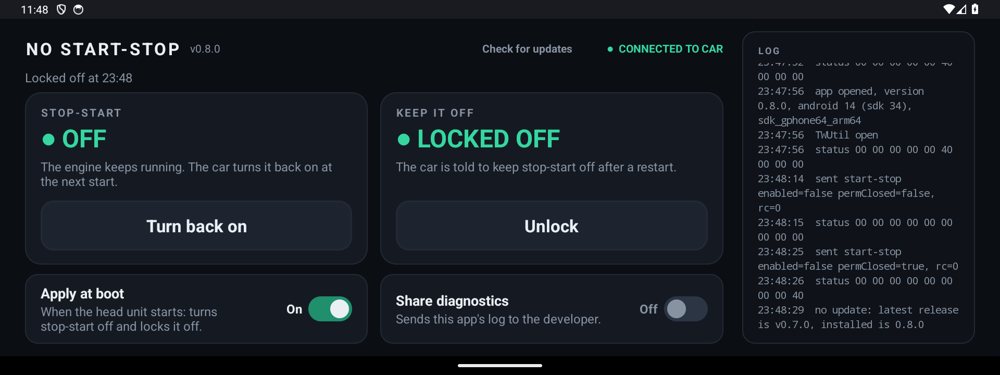
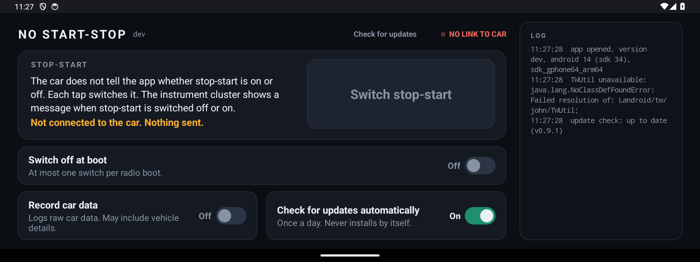

# No Start-Stop

Android app for Topway head units (TS18 and similar) that turns the PSA engine stop-start feature off through the Raise CAN box, the same way the built-in "Original Car" settings app does.

Built for a Peugeot/Citroën Jumpy (2015–23) with CAN box setting `02: Raise` / `96: PSA Peugeot Citroen`. It has not been confirmed on a real head unit yet: see [Status](#status).




The screenshots are from an emulator at 1920x720 with a simulated CAN box. On a device without the Topway framework the app shows the state as unknown instead of guessing:



## What it does

- **Engine stop-start**: shows whether stop-start is on or off and toggles it. The car resets this at every ignition cycle.
- **Stop-start service**: shows whether the service is controllable or permanently closed and toggles it.
- **Apply at boot**: off by default. When on, the app turns stop-start off and closes the service once after the head unit boots, then stops.
- **Log**: the commands sent and any errors.

## Install from a USB pendrive

1. Download `nostartstop-vX.Y.Z.apk` from the [Releases](../../releases) page, or build it yourself (see [Build](#build)).
2. Copy the APK to a FAT32 or exFAT pendrive.
3. Plug the pendrive into the head unit's USB port.
4. Open the head unit's **APK Installer** app (or its file manager), pick the USB drive and tap the APK.
5. If Android asks, allow installing from unknown sources for that app, then tap **Install**.
6. Open **No Start-Stop** once from the app list. Android does not deliver the boot event to an app that has never been opened.
7. Turn **Apply at boot** on if you want it applied automatically.

To update, install the new APK over the old one the same way. Release APKs all share one signing key, so they update each other. A locally built APK is signed with your own debug key: uninstall the old version before switching between a release and a local build.

## Install with adb

```sh
adb install -r build/nostartstop.apk
adb shell am start -n com.furgo.nostartstop/.MainActivity
adb logcat -s NoStartStop
```

## Build

Needs JDK 17 and the Android SDK with `build-tools/34.0.0` and `platforms/android-34`. No gradle.

### Set up the tools (macOS)

1. Install JDK 17, with either:

   ```sh
   asdf plugin add java && asdf install    # reads .tool-versions
   ```

   ```sh
   brew install --cask temurin@17
   ```

2. Install the Android SDK packages. If you have Android Studio, use its SDK Manager. Otherwise:

   ```sh
   brew install --cask android-commandlinetools
   sdkmanager "build-tools;34.0.0" "platforms;android-34" "platform-tools"
   ```

3. Point `ANDROID_HOME` at the SDK if it is not in `~/Library/Android/sdk` (Android Studio's default). For the Homebrew command line tools:

   ```sh
   export ANDROID_HOME="$(brew --prefix)/share/android-commandlinetools"
   ```

### Build the APK

```sh
sh build.sh
```

The result is `build/nostartstop.apk`, signed with the local debug key in `~/.android/debug.keystore` (created on first build). That is fine for sideloading onto your own head unit.

To sign with a stable key instead, set `KEYSTORE` (a PKCS12 file), `KS_PASS` and `KEY_ALIAS`. `VERSION_NAME` and `VERSION_CODE` set the version stamped into the APK.

## CI and releases

GitHub Actions (`.github/workflows/build.yml`) builds the APK on every push to `master` and on pull requests, and keeps it as a workflow artifact.

Pushing a tag `vX.Y.Z` also publishes a GitHub release with `nostartstop-vX.Y.Z.apk` attached. `v0.*` tags are marked as pre-releases.

```sh
git tag v0.2.0 && git push origin v0.2.0
```

Releases are signed with the key in the repository secrets `RELEASE_KEYSTORE_B64` (base64 of a PKCS12 keystore, alias `release`) and `RELEASE_KEYSTORE_PASSWORD`. A tag build fails if they are missing. Keep a copy of that keystore: if it is lost, later releases cannot update earlier installs.

## How it works

The head unit's MCU relays CAN box frames through the framework class `android.tw.john.TWUtil`. `stubs/` holds a compile-only stub of it; the real class comes from the device.

| Action | Call |
|---|---|
| Query settings status | `write(1281, 143, 2, {56, 0})` |
| Set stop-start | `write(1281, 128, 2, {13, value})`, bit 0 = stop-start enabled, bit 7 = service permanently closed |
| Status frame | message `what = 1281`, `arg1 = 56`; `byte[5]` bit 6 = stop-start enabled, `byte[8]` bit 6 = permanently closed |

These were read from the decompiled vendor app `com.tw.car` (`PsaRaiseSettingsActivity`).

## Status

- Builds, and the UI runs on an emulator against a simulated CAN box.
- Not yet run on a real head unit, so the frames above are unconfirmed on a vehicle.

## Troubleshooting

- **Log shows `TWUtil unavailable`**: Android is blocking the vendor class for a non-system app. With adb: `adb shell settings put global hidden_api_policy 1`.
- **State stays UNKNOWN but the CAN box is live**: the status frame layout differs on your car. The buttons still send; the log shows what was sent.
- **Apply at boot does nothing**: open the app once after installing. Many head units also sleep on ignition-off instead of rebooting, and the app only acts on a real boot.
