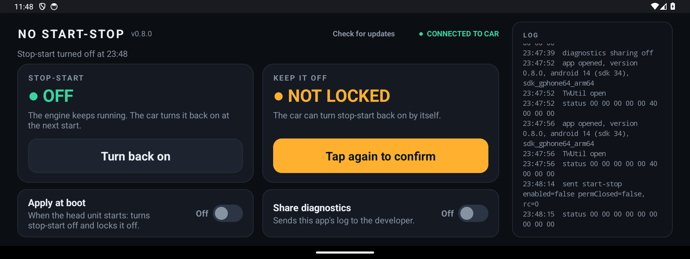

# No Start-Stop

Android app for Topway head units (TS18 and similar) that turns the PSA engine stop-start feature off through the Raise CAN box, the same way the built-in "Original Car" settings app does.

Built for a Peugeot/Citroën Jumpy (2015–23) with CAN box setting `02: Raise` / `96: PSA Peugeot Citroen`. It has not been confirmed on a real head unit yet: see [Status](#status).


The screenshots are from an emulator at 1920x720 with a simulated CAN box. On a device without the Topway framework the app shows the state as unknown instead of guessing, and its buttons send nothing:


## What it does

- **Stop-start**: shows whether stop-start is on or off, with a button to turn it off or back on. The car turns it back on at every start.
- **Keep it off**: shows whether stop-start is locked off, with a button to lock or unlock it. Locking tells the car to keep stop-start off after a restart (the vendor app calls this "permanently closed"). **Lock off** asks for a second tap to confirm:

  

- **Feedback**: a tapped button shows "Sending…" until the car answers, and says so if it does not. A line above the cards shows the last change, for example "Locked off at 23:48".
- **Apply at boot**: off by default. When on, the app turns stop-start off and locks it off once after the head unit boots, then stops.
- **Log**: the commands sent and any errors.
- **Check for updates**: downloads and installs the latest release when you ask for it.
- **Share diagnostics**: asked on first launch, with a switch to change it later. Sends the app's log lines to the developer.

## Install from a USB pendrive

1. Download `nostartstop-vX.Y.Z.apk` from the [Releases](../../releases) page, or build it yourself (see [Build](#build)).
2. Copy the APK to a FAT32 or exFAT pendrive.
3. Plug the pendrive into the head unit's USB port.
4. Open the head unit's **APK Installer** app (or its file manager), pick the USB drive and tap the APK.
5. If Android asks, allow installing from unknown sources for that app, then tap **Install**.
6. Open **No Start-Stop** once from the app list. Android does not deliver the boot event to an app that has never been opened.
7. Turn **Apply at boot** on if you want it applied automatically.

To update, install the new APK over the old one the same way. Release APKs all share one signing key, so they update each other. A locally built APK is signed with your own debug key: uninstall the old version before switching between a release and a local build.

## Updating from the app

With the head unit online (phone hotspot or Wi-Fi):

1. Tap **Check for updates** at the top of the screen. The button changes to **Install vX.Y.Z** if a newer release exists, or **Up to date**.
2. Tap **Install vX.Y.Z**. The app downloads the APK and Android asks you to confirm the update.
3. The first time, Android says the app is not allowed to install unknown apps. Tap **Settings**, allow it for No Start-Stop, go back and tap **Install** again.
4. The app closes when the update finishes. Open it again; the new version is shown next to the title. Settings and the log are kept.

The app only uses the network when you tap that button. It asks `api.github.com` for this repository's latest release and downloads the APK from `github.com`; it sends nothing else. Android refuses any APK that is not signed with the same key as the installed app, so a locally built (debug-signed) install cannot be updated this way.

## Diagnostics

The first time a release build is opened it asks **Share diagnostics?**. Nothing is sent before you answer. If you choose **Share**, each line the app writes to its log is also sent to the developer's [PostHog](https://posthog.com) project, so problems can be diagnosed without copying the log file by hand. The **Share diagnostics** switch on the main screen changes your answer at any time.

What is sent with each line:

- the log line itself (the same text as in the LOG panel: commands sent, CAN box status frames, errors, boot activity);
- the app version, the Android SDK level and the head unit's model name;
- a random id created for this install, so lines from one head unit can be told apart. It is not tied to you or to the vehicle.

Nothing is sent while the switch is off. Lines logged while the head unit is offline are kept (up to 500) and sent the next time a line is logged with a connection. Switching it off discards anything not sent yet and forgets the random id, so switching it on again starts with a new one.

The switch only appears in builds made with a PostHog key. Release builds get it from the repository variables `POSTHOG_KEY` and `POSTHOG_HOST`; a local build has no key unless you set those environment variables for `build.sh`. The key is a public, write-only project key.

## Getting the log off the head unit

The app writes everything shown in its LOG panel, plus what the boot service did, to a text file:

```
Android/data/com.furgo.nostartstop/files/nostartstop.log
```

on the head unit's internal storage (full path `/storage/emulated/0/Android/data/com.furgo.nostartstop/files/nostartstop.log`). When it passes 512 KB it is renamed to `nostartstop.log.1` and a new file is started.

To copy it without adb:

1. Plug a pendrive into the head unit.
2. Open the head unit's file manager and go to internal storage, then `Android/data/com.furgo.nostartstop/files/`.
3. Copy `nostartstop.log` to the pendrive.

Each line has a date and time. Lines to look for:

- `app opened, version …, android …`: app and Android version.
- `TWUtil open` / `TWUtil unavailable: …`: whether the head unit's MCU link works.
- `status 00 00 …`: the raw settings frame from the CAN box, logged whenever it changes.
- `sent start-stop enabled=… permClosed=…, rc=…`: a command sent to the CAN box.
- `boot: …`: what the boot service did.

With adb the same file is at `adb pull /sdcard/Android/data/com.furgo.nostartstop/files/nostartstop.log`.

## Install with adb

```sh
adb install -r build/nostartstop.apk
adb shell am start -n com.furgo.nostartstop/.MainActivity
adb logcat -s NoStartStop
```

## Build

Needs JDK 17 and the Android SDK with `build-tools/34.0.0` and `platforms/android-34`. No gradle.

### Set up the tools (macOS)

1. Install JDK 17, with either:

   ```sh
   asdf plugin add java && asdf install    # reads .tool-versions
   ```

   ```sh
   brew install --cask temurin@17
   ```

2. Install the Android SDK packages. If you have Android Studio, use its SDK Manager. Otherwise:

   ```sh
   brew install --cask android-commandlinetools
   sdkmanager "build-tools;34.0.0" "platforms;android-34" "platform-tools"
   ```

3. Point `ANDROID_HOME` at the SDK if it is not in `~/Library/Android/sdk` (Android Studio's default). For the Homebrew command line tools:

   ```sh
   export ANDROID_HOME="$(brew --prefix)/share/android-commandlinetools"
   ```

### Build the APK

```sh
sh build.sh
```

The result is `build/nostartstop.apk`, signed with the local debug key in `~/.android/debug.keystore` (created on first build). That is fine for sideloading onto your own head unit.

To sign with a stable key instead, set `KEYSTORE` (a PKCS12 file), `KS_PASS` and `KEY_ALIAS`. `VERSION_NAME` and `VERSION_CODE` set the version stamped into the APK.

## CI and releases

GitHub Actions (`.github/workflows/ci.yml`) runs on every push to `master` and on pull requests:

- **test**: `shellcheck` on the scripts and the unit tests (`sh test.sh`). The tests cover the CAN box frame encoding and status decoding in `Protocol.java`, and the version bump rules; they need only a JDK.
- **security**: `gitleaks` scans the commits for leaked secrets and `zizmor` audits the workflow file. Actions are pinned to commit SHAs.
- **build**: compiles with javac warnings as errors, builds the APK, checks its contents (launcher activity, boot components, and that the `TWUtil` stub is not packaged) and keeps it as a workflow artifact.

Nothing in CI talks to a head unit or a CAN box.

### Releases

Merging a pull request into `master` publishes a release automatically, depending on the prefix of the merged branch (`scripts/next-version.sh`):

| Branch prefix | Version bump | Example |
|---|---|---|
| `breaking/`, `major/` | major | `v0.3.1` → `v1.0.0` |
| `feat/`, `feature/` | minor | `v0.3.1` → `v0.4.0` |
| `fix/`, `perf/` | patch | `v0.3.1` → `v0.3.2` |
| anything else (`ci/`, `docs/`, `chore/`, `refactor/`, `test/`, `renovate/`, …) | no release | |

The release is tagged `vX.Y.Z` on the merge commit and has `nostartstop-vX.Y.Z.apk` attached. Its notes are the pull request's title and description, so write the description as a changelog for someone installing the APK. Commits pushed straight to `master` without a pull request do not release.

To release by hand instead, push a tag (the notes are then GitHub's generated list of changes):

```sh
git tag v0.2.0 && git push origin v0.2.0
```

[Renovate](https://docs.renovatebot.com/) (`renovate.json`) opens pull requests for new versions of the GitHub Actions (keeping them pinned to commit SHAs) and the pinned JDK patch level. It needs the Renovate GitHub App installed on the repository.

Releases are signed with the key in the repository secrets `RELEASE_KEYSTORE_B64` (base64 of a PKCS12 keystore, alias `release`) and `RELEASE_KEYSTORE_PASSWORD`. A release build fails if they are missing. Keep a copy of that keystore: if it is lost, later releases cannot update earlier installs.

## How it works

The head unit's MCU relays CAN box frames through the framework class `android.tw.john.TWUtil`. `stubs/` holds a compile-only stub of it; the real class comes from the device.

| Action | Call |
|---|---|
| Query settings status | `write(1281, 143, 2, {56, 0})` |
| Set stop-start | `write(1281, 128, 2, {13, value})`, bit 0 = stop-start enabled, bit 7 = service permanently closed |
| Status frame | message `what = 1281`, `arg1 = 56`; `byte[5]` bit 6 = stop-start enabled, `byte[8]` bit 6 = permanently closed |

These were read from the decompiled vendor app `com.tw.car` (`PsaRaiseSettingsActivity`).

## Status

- Builds, and the UI runs on an emulator against a simulated CAN box.
- Not yet run on a real head unit, so the frames above are unconfirmed on a vehicle.

## Troubleshooting

- **Log shows `TWUtil unavailable`**: Android is blocking the vendor class for a non-system app. With adb: `adb shell settings put global hidden_api_policy 1`.
- **"NO LINK TO CAR" and grey buttons**: the app could not open the head unit's link to the car, usually the `TWUtil unavailable` case above. Nothing is sent in this state.
- **State stays UNKNOWN while it says "CONNECTED TO CAR" or "CONNECTING…"**: the status frame layout differs on your car. The buttons still send; the log shows what was sent.
- **Apply at boot does nothing**: open the app once after installing. Many head units also sleep on ignition-off instead of rebooting, and the app only acts on a real boot.
