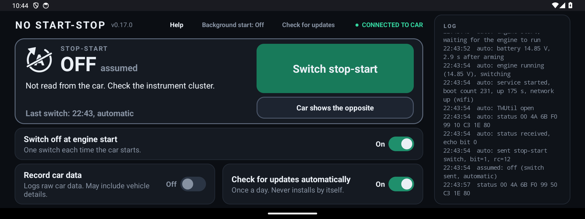
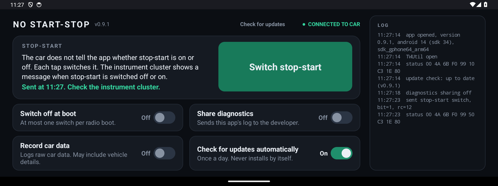

# No Start-Stop


Android app for Topway head units (TS18 and similar) that switches the PSA engine stop-start feature off through the Raise CAN box, the same way the built-in "Original Car" settings app does.

Built for a Citroën Jumpy (2015–23) with CAN box setting `02: Raise` / `96: PSA Peugeot Citroen`, and tested on a real Jumpy head unit (Android 10). See [Status](#status).

The Jumpy shares its platform and electronics with these vans, so the app should work on them with the same head unit and CAN box setting. None of them has been tested:

| Brand | Van | Passenger version |
|---|---|---|
| Citroën | Jumpy / Dispatch | SpaceTourer |
| Peugeot | Expert | Traveller |
| Opel / Vauxhall | Vivaro (2019 on) | Zafira Life / Vivaro Life |
| Toyota | ProAce (2016 on) | ProAce Verso |
| Fiat | Scudo (2022 on) | Ulysse |

## Why

On recent Euro 6 versions of these vans the physical stop-start button is gone, and the plug-in modules that used to press it for you no longer work. Stop-start comes back on at every engine start, so the only way left is to go through the touchscreen menu on every trip. This app does that step for you, from one button or by itself when the engine starts.

It changes nothing in the car: no ECU reflash, no coding, no wiring. It sends the same command the car's own settings menu sends. Turn the automatic option off or uninstall the app and the van behaves exactly as it left the factory, for example for an inspection.





The screenshots are from an emulator at 1920x720 with a simulated CAN box. On a device without the Topway framework the button is grey and sends nothing:


## What it does

- **Switch stop-start**: one button that sends one switch command to the car. The command is a toggle: each tap turns stop-start off if it was on, and on if it was off.
- **No on/off display**: the car does not report whether stop-start is on or off, so the app does not show it. The instrument cluster shows a message when stop-start is switched off or on; look there after a tap.
- **Feedback**: a tap first asks the CAN box for a fresh status frame and picks the command from it, then sends. The button shows "Sending…" meanwhile. The card then says:
  - "Sent at HH:mm. Check the instrument cluster." once the CAN box echoes the command. When the command's bit is 0 the echo cannot confirm it, so this shows as soon as it is sent.
  - "No answer from the car." when the command was sent but not echoed within 3 seconds. Check the instrument cluster before tapping again: the switch may have worked.
  - "No answer from the car. Nothing sent." when no status frame came within 3 seconds, and "Could not send to the car. Nothing sent." when the head unit refused the command.

  Taps are ignored while a command is pending, for 2 seconds after each command is sent, and while **Switch off at engine start** is sending ("Switching…"), so a double tap does not switch it straight back. When idle, the card shows the last switch sent since the head unit last woke up, for example "Last switch: 08:41, automatic".
- **Switch off at engine start**: off by default. When on, the app sends one switch command each time the car starts. The car turns stop-start on at every engine start, so one switch turns it off. See [how it works and its limits](#switch-off-at-engine-start-how-and-limits).
- **Record car data**: off by default. When on, the log also records the raw frames the CAN box passes on from the car, the trip computer frame, engine speed (rpm) and vehicle speed, battery voltage and the head unit's identity and configuration, to help find where the car reports the real stop-start state. This data may include vehicle details (for example the VIN, speed or position), so leave it off unless you are helping with that.
- **Log**: the commands sent, the CAN box status frames, the CAN box function frame, boot, screen, shutdown and network events, and any errors.
- **Check for updates**: downloads and installs the latest release when you ask for it.
- **Check for updates automatically**: on by default. About once a day, and after a boot once there is a connection, the app checks for a new release and shows a notification. It never installs by itself. See [Updating from the app](#updating-from-the-app).
- **Share diagnostics**: asked on first launch, with a switch to change it later. Sends the app's log lines to the developer.

There is no "keep it off" or lock option: the vendor app's "permanently closed" setting has no effect on this van, and stop-start is on again after every engine start whatever it is set to.

### Switch off at engine start: how and limits

The head unit does not reboot at each engine start. At ignition off it reports power state 1 and stops the app a few seconds later; at ignition on it starts the app again. While the option is on, the app keeps a small background service running (with a silent notification) that listens to the head unit's power state and battery voltage.

A new ignition cycle starts when:

- the service starts after the head unit last reported ignition off (the app remembers this across the restart), or
- the engine is started: the head unit reports a crank (power state 9) and then 6 a few seconds later.

After that the app waits until a battery reading of 13.0 V or more arrives, at least 5 seconds have passed and no crank is in progress, and then sends one switch. After an engine start, readings from the crank count too. After an engine start, if the engine is not seen running within 3 minutes, nothing is sent. After an ignition on there is no time limit, since the app may be restarted while the head unit is still off; it waits until the engine runs or the ignition is reported off again. Without battery readings nothing is sent. Each engine start gets its own switch, because the car turns stop-start back on every time; two crank ends less than 5 seconds apart count as one.

- The app must be running at engine start. Today that is only known to happen when it was the last app on screen at ignition off, because the head unit then reopens it. Otherwise nothing is sent and stop-start stays on.
- It sends at most one switch per cycle, and none if you already switched from the screen in that cycle. An engine start after a switch, by tap or automatic, always starts a new cycle, because the engine start turned stop-start back on.
- A boot, a restart or an update of the app counts as ignition on only if the ignition was reported off before it and no switch was sent since, by the app or by a tap. Then stop-start is on, so if the engine is already running the app sends one switch, even late in a drive. Otherwise such a start sends nothing.
- A charger that holds the battery at 13.0 V or more with the engine off can make the app send one switch it should not.
- Broadcasts such as `ACC_ON` are only logged. Any app can send them, so they never start a cycle or cause a switch.
- If the link to the car does not come up within 30 seconds, nothing is sent.
- If the head unit refuses the command, nothing is sent and it is not retried until the next wake. The main screen then says "Automatic switch failed. Tap to switch." until you switch from the screen.

## Install from a USB pendrive

1. Download `nostartstop-vX.Y.Z.apk` from the [Releases](../../releases) page, or build it yourself (see [Build](#build)).
2. Copy the APK to a FAT32 or exFAT pendrive.
3. Plug the pendrive into the head unit's USB port.
4. Open the head unit's **APK Installer** app (or its file manager), pick the USB drive and tap the APK.
5. If Android asks, allow installing from unknown sources for that app, then tap **Install**.
6. Open **No Start-Stop** once from the app list. Android does not deliver the boot event to an app that has never been opened.
7. Turn **Switch off at engine start** on if you want it sent automatically.

To update, install the new APK over the old one the same way. Release APKs all share one signing key, so they update each other. A locally built APK is signed with your own debug key: uninstall the old version before switching between a release and a local build.

## Updating from the app

With the head unit online (phone hotspot or Wi-Fi):

1. Tap **Check for updates** at the top of the screen. The button changes to **Install vX.Y.Z** if a newer release exists, or **Up to date**. If the automatic check already found one, the button shows **Install vX.Y.Z** as soon as you open the app.
2. Tap **Install vX.Y.Z**. The app downloads the APK and Android asks you to confirm the update.
3. The first time, Android says the app is not allowed to install unknown apps. Tap **Settings**, allow it for No Start-Stop, go back and tap **Install** again.
4. The app closes when the update finishes. Open it again; the new version is shown next to the title. Settings and the log are kept.

### Automatic check

With **Check for updates automatically** on (the default), Android runs a background check about once a day, after each boot and when you open the app, but only while there is a network connection, and at most once every 6 hours. It asks `api.github.com` for this repository's latest release; it sends nothing else. If a newer release exists, a silent notification says "Update vX.Y.Z available" (once per release), and tapping it opens the app. The check never downloads or installs anything: installing still needs your tap on **Install vX.Y.Z** and Android's confirmation. Each check writes one line to the log, for example `update check: up to date (v0.9.1)`, `update check: v0.9.2 available` or `update check failed: no internet` (a repeated failure is logged once). Failed checks are retried later by Android, not in a loop.

Turn the switch off to stop all background update checks. The **Check for updates** button keeps working.

Apart from that check and **Share diagnostics**, the app only uses the network when you tap the button: it asks `api.github.com` for the latest release and downloads the APK from `github.com`. Android refuses any APK that is not signed with the same key as the installed app, so a locally built (debug-signed) install cannot be updated this way.

## Diagnostics

The first time a release build is opened it asks **Share diagnostics?**. Nothing is sent before you answer. If you choose **Share**, each line the app writes to its log is also sent to the developer's [PostHog](https://posthog.com) project, so problems can be diagnosed without copying the log file by hand. The **Share diagnostics** switch on the main screen changes your answer at any time. With **Record car data** on, the log also holds raw car data that may include vehicle details. Lines are uploaded in batches, at most one request every 3 seconds.

What is sent with each line:

- the log line itself (the same text as in the LOG panel: commands sent, CAN box status frames, errors, boot activity);
- the app version, the Android SDK level and the head unit's model name;
- a random id created for this install, so lines from one head unit can be told apart. It is not tied to you or to the vehicle.

Always logged: the commands sent, the status (`status …`) and function (`function …`) frames from the CAN box, boot count and uptime, screen on/off, shutdown and network up/down. The function frame is expected to hold only the car's feature flags, but that is not verified. Only logged while **Record car data** is on: `frame …`, `engine …`, `battery …`, `unit id …` and `unit config …`, and the engine speed on `sent stop-start switch` lines. Those lines are only sent if **Share diagnostics** is on too. Switching **Record car data** off stops new lines; lines already in the log file stay there.

Nothing is sent while the switch is off. Lines logged while the head unit is offline are kept in the app's private storage, one file per day (UTC). Once a day is over its file is compressed. Together they are kept up to 5 MB or 30 days; past that the oldest days are deleted first. The current day may use at most 1 MB of that, so a burst of lines drops its own oldest lines instead of older days. They are sent the next time a line is logged with a connection, or by the background job that Android runs once there is a network after a boot, when the app is opened and about once a day (logged as `diagnostics: sent N queued lines`). The current day goes first, then the older days from oldest to newest, up to 500 lines per request and 20 requests at a time; the rest waits for the next send. After a failed upload, new lines wait 1 minute before the next try, doubling up to 15 minutes; the background job always tries. That job runs for this alone when **Check for updates automatically** is off. Switching it off discards anything not sent yet and forgets the random id, so switching it on again starts with a new one.

The switch only appears in builds made with a PostHog key. Release builds get it from the repository variables `POSTHOG_KEY` and `POSTHOG_HOST`; a local build has no key unless you set those environment variables for `build.sh`. The key is a public, write-only project key.

## Getting the log off the head unit

The app writes everything shown in its LOG panel, plus what its background services did, to a text file:

```
Android/data/com.furgo.nostartstop/files/nostartstop.log
```

on the head unit's internal storage (full path `/storage/emulated/0/Android/data/com.furgo.nostartstop/files/nostartstop.log`). When it passes 512 KB it is renamed to `nostartstop.log.1` and a new file is started.

To copy it without adb:

1. Plug a pendrive into the head unit.
2. Open the head unit's file manager and go to internal storage, then `Android/data/com.furgo.nostartstop/files/`.
3. Copy `nostartstop.log` to the pendrive.

Each line has a date and time. Lines to look for:

- `app opened, version …, android …, boot count 7, up 42 s, network up (wifi)`: app and Android version, how many times the head unit has booted, seconds since it booted, and the network state. `boot count unknown` before Android 7.
- `TWUtil open` / `TWUtil unavailable: …`: whether the head unit's MCU link works. With **Record car data** on, `TWUtil open, CAN box only (engine and unit ids refused: …)` means the head unit refused the engine and unit messages; the switch works the same.
- `status 00 4A …`: the raw settings frame (id 56) from the CAN box, logged whenever it changes.
- `function 05 12 02 01 (stop-start field=2)`: the CAN box function frame (id 57), asked for after the first status frame when the link opens and 1.5 and 5 seconds after each switch, logged when it changes since the app started (at most 40 lines each time the app connects). The field is a candidate for the real stop-start state (1 on, 2 off, 0 not reported); it is not verified and the app does not use it.
- `frame <id> …`: any other CAN box frame, only while **Record car data** is on. Logged when it changes, at most 20 lines per frame id, 64 frame ids and 400 lines in total each time the app connects. The trip computer frame (51) is asked for when the link opens and after each switch. The automatic switch never records them.
- `engine rpm=… speed=…` and `battery 12.34 V`: only while **Record car data** is on, except that `watch: battery …` is logged whenever **Switch off at engine start** is on. Logged when they change noticeably, at most one of each every 10 seconds and 100 of each each time the app connects. `rpm=?` means the head unit reported it as invalid.
- `unit id …` / `unit config …`: the head unit's identity text and configuration block, once each time the app starts, only while **Record car data** is on.
- `sent stop-start switch, bit=…, rc=…`: a switch command sent to the CAN box. With **Record car data** on and the engine speed known, it ends with `, rpm=…`.
- `auto: …`: what the automatic switch did, including why it sent or did not send and whether the CAN box echoed the command. `watch: …` lines come from the background service that waits for the engine.
- `process started, pid …`, `wake <n> (<source>)`, `power state <n>` and `broadcast <action> (manifest|runtime), up … s`: what the app sees across ignition cycles, to learn how the head unit sleeps and wakes. `watch: service started (…)` says how the service was started (by the app, at boot, after update, by a broadcast or restarted by the system). Capped at 30 `wake`, 60 `power state`, 30 `broadcast` and 60 `auto: battery` lines per 24 hours; the other `auto:` and `watch:` lines are capped too.
- `screen off, up … s` / `screen on, up … s`, `network up (…)` / `network down`: while the app is open, at most 50 network lines each time the app starts.
- `shutdown, up … s`: the head unit shut down cleanly. Android 9 and later only tell the app while it is running (open or in the background), so on those a missing line does not prove a power cut.

With adb the same file is at `adb pull /sdcard/Android/data/com.furgo.nostartstop/files/nostartstop.log`.

## Install with adb

```sh
adb install -r build/nostartstop.apk
adb shell am start -n com.furgo.nostartstop/.MainActivity
adb logcat -s NoStartStop
```

## Build

Needs JDK 17 and the Android SDK with `build-tools/34.0.0` and `platforms/android-34`. No gradle.

### Set up the tools (macOS)

1. Install JDK 17, with either:

   ```sh
   asdf plugin add java && asdf install    # reads .tool-versions
   ```

   ```sh
   brew install --cask temurin@17
   ```

2. Install the Android SDK packages. If you have Android Studio, use its SDK Manager. Otherwise:

   ```sh
   brew install --cask android-commandlinetools
   sdkmanager "build-tools;34.0.0" "platforms;android-34" "platform-tools"
   ```

3. Point `ANDROID_HOME` at the SDK if it is not in `~/Library/Android/sdk` (Android Studio's default). For the Homebrew command line tools:

   ```sh
   export ANDROID_HOME="$(brew --prefix)/share/android-commandlinetools"
   ```

### Build the APK

```sh
sh build.sh
```

The result is `build/nostartstop.apk`, signed with the local debug key in `~/.android/debug.keystore` (created on first build). That is fine for sideloading onto your own head unit.

The launcher icon is drawn in `art/icon.svg`. After editing it, regenerate the PNGs in `res/mipmap-*` (48, 72, 96, 144 and 192 px) with Inkscape or `rsvg-convert`.

To sign with a stable key instead, set `KEYSTORE` (a PKCS12 file), `KS_PASS` and `KEY_ALIAS`. `VERSION_NAME` and `VERSION_CODE` set the version stamped into the APK.

## CI and releases

GitHub Actions (`.github/workflows/ci.yml`) runs on every push to `master` and on pull requests:

- **test**: `shellcheck` on the scripts and the unit tests (`sh test.sh`). The tests cover the CAN box frame encoding, the echo bit, the switch value and the parsing of the logged diagnostic data in `Protocol.java`, the boot id and the boot facts in `BootId.java`, the ignition cycle rules in `WakeRules.java`, the reading of the power state (ignition off, engine crank) in `PowerWatch.java`, when the automatic switch fires in `AutoSwitch.java`, the log caps in `LogBudget.java`, the diagnostics storage (per-day files, compression, upload order and size limits) in `TelemetryStore.java`, and the version bump rules; they need only a JDK.
- **security**: `gitleaks` scans the commits for leaked secrets and `zizmor` audits the workflow file. Actions are pinned to commit SHAs.
- **build**: compiles with javac warnings as errors, builds the APK, checks its contents (launcher activity, boot components, and that the `TWUtil` stub is not packaged) and keeps it as a workflow artifact.

Nothing in CI talks to a head unit or a CAN box.

### Releases

Merging a pull request into `master` publishes a release automatically, depending on the prefix of the merged branch (`scripts/next-version.sh`):

| Branch prefix | Version bump | Example |
|---|---|---|
| `breaking/`, `major/` | major | `v0.3.1` → `v1.0.0` |
| `feat/`, `feature/` | minor | `v0.3.1` → `v0.4.0` |
| `fix/`, `perf/` | patch | `v0.3.1` → `v0.3.2` |
| anything else (`ci/`, `docs/`, `chore/`, `refactor/`, `test/`, `renovate/`, …) | no release | |

The release is tagged `vX.Y.Z` on the merge commit and has `nostartstop-vX.Y.Z.apk` attached. Its notes are the pull request's title and description, so write the description as a changelog for someone installing the APK. Commits pushed straight to `master` without a pull request do not release.

To release by hand instead, push a tag (the notes are then GitHub's generated list of changes):

```sh
git tag v0.2.0 && git push origin v0.2.0
```

[Renovate](https://docs.renovatebot.com/) (`renovate.json`) opens pull requests for new versions of the GitHub Actions (keeping them pinned to commit SHAs) and the pinned JDK patch level. It needs the Renovate GitHub App installed on the repository.

Releases are signed with the key in the repository secrets `RELEASE_KEYSTORE_B64` (base64 of a PKCS12 keystore, alias `release`) and `RELEASE_KEYSTORE_PASSWORD`. A release build fails if they are missing. Keep a copy of that keystore: if it is lost, later releases cannot update earlier installs.

## How it works

The head unit's MCU relays CAN box frames through the framework class `android.tw.john.TWUtil`. `stubs/` holds a compile-only stub of it; the real class comes from the device.

| Action | Call |
|---|---|
| Query settings status | `write(1281, 143, 2, {56, 0})` |
| Switch stop-start | `write(1281, 128, 2, {13, value})`. Every command that changes bit 0 flips stop-start on the car, so the app sends the opposite of the echo bit in a status frame it has just asked for (the automatic switch sends 1 if no frame arrives within 5 seconds). Bit 7 ("service permanently closed") has no effect on this van and is always sent as 0 |
| Status frame | message `what = 1281`, `arg1 = 56`, 9 bytes. `byte[5]` bit 6 echoes bit 0 of the last command and clears by itself after about 8 seconds; it is **not** the stop-start state. No byte of this frame was seen to follow the real state |

These were read from the decompiled vendor app `com.tw.car` (`PsaRaiseSettingsActivity`) and checked on the van. The vendor app reads `byte[5]` bit 6 as the stop-start state, so it shows the same wrong value.

The app also logs these, which come from the vendor code and are **not verified** on the van. Nothing depends on them:

| Data | Call |
|---|---|
| Function frame (candidate stop-start state) | query `write(1281, 143, 2, {57, 0})`, answered as frame 57. `byte[2]` bits 1-0 may be the state (1 on, 2 off, 0 not reported); the box may instead answer with a text list, so the raw bytes are logged |
| Trip computer | query `write(1281, 143, 2, {51, 0})`, answered as frame 51 |
| Engine | message `what = 1291`: `arg1` speed, `arg2` rpm (65535 invalid) |
| Battery | message `what = 1292`, `arg1 = 0`: `((b[0] & 0x7F) << 8 \| b[1]) * 0.01` V when `b[0]` bit 7 is clear |
| Head unit identity | `write(266, 255, 0)` answered by `what = 266` with a text; `write(267, 255, 0)` by `what = 267` with a block of bytes |

The engine, battery and identity messages are only opened, together with the CAN box, while **Record car data** is on. Turning it on takes effect for them the next time the app's screen is shown. If the head unit refuses them, the app opens the CAN box alone, as before. The automatic switch opens the CAN box alone to send; its background service opens only the power state (514) and battery messages, and reopens them if they stay silent for a minute.

## Status

- Tested on a real Jumpy head unit (Android 10). The switch command works: every command that changes bit 0 flips stop-start, and the instrument cluster shows a message each time.
- The car's real stop-start state is not readable through the settings frame. The app logs the function frame (`function …` lines), a candidate for it, and with **Record car data** on the other CAN box frames (`frame …` lines) so it can be looked for.
- "Permanently closed" does nothing on this van.

## Troubleshooting

- **Log shows `TWUtil unavailable`**: Android is blocking the vendor class for a non-system app. With adb: `adb shell settings put global hidden_api_policy 1`.
- **"NO LINK TO CAR" and a grey button**: the app could not open the head unit's link to the car, usually the `TWUtil unavailable` case above. Nothing is sent in this state.
- **"No answer from the car."**: the command was sent but the CAN box did not echo it within 3 seconds. Check the instrument cluster before tapping again, since the switch may have worked, and the log for the `sent stop-start switch` line and its `rc`.
- **"No answer from the car. Nothing sent."**: the CAN box did not send a status frame within 3 seconds of the tap, so no command was sent. Wait for "CONNECTED TO CAR" and tap again.
- **The instrument cluster showed no message after a tap**: the command may not have changed bit 0 for the car, or the car ignored it. Wait 10 seconds, then tap once more and watch the cluster. If it still shows nothing, share the log: the `sent stop-start switch` and `status` lines around the tap show what happened.
- **Stop-start ends up on after a tap**: each tap flips it, so it was off before. Tap once more and check the instrument cluster message.
- **Switch off at engine start does nothing**: open the app once after installing. Then check the log for `wake` and `auto:` lines after an engine start; without a `wake` line the app did not notice the ignition on or the engine start. `auto: battery …` lines show the voltages it saw while waiting.
- **Stop-start is on after an engine start with Switch off at engine start on**: the head unit probably woke or booted twice in the same engine run, so the second switch turned it back on. Tap the button once.

## License

[MIT](LICENSE).
